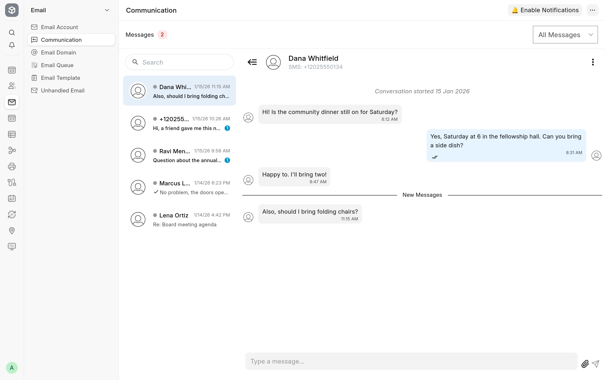

<!-- Copyright (c) 2026, Avunu LLC and contributors
For license information, please see license.txt-->

<!-- frappe-nix:begin header -->

<div align="center">


# Messaging

Chat inbox for email and SMS, Twilio group texts and newsletter merge tags

[](https://github.com/Avunu/messaging/actions/workflows/ci.yml)
[](https://github.com/Avunu/messaging/releases)
[](license.txt)
[](https://github.com/frappe/frappe/tree/version-16)
[](https://docs.avunu.net/messaging/)

<picture>
  <source media="(prefers-color-scheme: dark)" srcset="docs/screenshots/chat-dark.webp">
  
</picture>

</div>

<!-- frappe-nix:end header -->

## Overview

Frappe keeps every e-mail and text message as a Communication, but reading them means opening one record at a time. This app puts them in a chat view: each conversation with a phone number or an e-mail address is a thread, the unanswered ones first, and staff answer from the same screen. It also sends and receives SMS through Twilio, texts whole groups of contacts, and fills in each recipient's name in newsletters.

It is for teams that talk to customers, members or volunteers by text and e-mail from one Frappe site. It needs Frappe v16 and the [newsletter](https://github.com/frappe/newsletter) app. ERPNext is not required.

The documentation's Markdown source is in [`docs/`](docs/README.md).

Full documentation: [docs.avunu.net/messaging/docs/](https://docs.avunu.net/messaging/docs/).

## Features

### Chat view

- **Chat** is a view of Communication and its default: one thread per medium and phone number or e-mail address, unanswered threads first and then the newest, with unread counts and a search across conversations.
- Show all messages, or only Email, SMS or Phone.
- Reply in a rich-text box: Enter sends, Shift+Enter starts a new line, and a message's **Reply** action quotes it. A reply goes out by the thread's medium, as an SMS or as an e-mail with your signature, and marks the message it answers as Replied. Received attachments show in the thread.
- New messages appear as they arrive, without a reload. With push notifications turned on, users also get a browser notification for each message received, even with the tab closed.
- A contact panel shows the contact behind a thread, their e-mail addresses and phone numbers and the documents linked to the conversation, or offers to create the contact.
- Archive a thread (close every message in it) or delete it. Each message links to its Communication and the document it refers to.
- The chat follows the desk's light or dark theme.

### SMS through Twilio

- Every SMS the site sends, from the chat, a group text or any other app that calls Frappe's `send_sms`, goes through Twilio when **Send via Twilio** is ticked, one recipient at a time, and an SMS Log records who received it. A number Twilio reports as unsubscribed has its contact's SMS consent cleared; one it reports as invalid is marked invalid.
- Texts sent to the Twilio number arrive through a webhook as received Communications, under the name of the contact who owns the number.
- STOP, STOPALL, UNSUBSCRIBE, CANCEL, END and QUIT from a known contact clear their SMS consent and mark them unsubscribed; START, YES and UNSTOP restore it. Each change leaves a comment on the contact.

### Contacts and phone numbers

- Saving a Contact rewrites its phone numbers in E.164 form (using the contact's address country, else the site's), removes duplicate numbers and e-mail addresses, and, with **Enable Phone Number Validation**, checks new and changed numbers with Twilio Lookup and records whether each is valid and its line type (mobile, landline, VoIP and so on). The primary phone and primary mobile then move to valid numbers.
- A **Consented to receive SMS** check on each Contact decides who may receive group texts.

### Groups, group texts and newsletters

- **Messaging Groups** collect contacts. Add one contact from its form, or many from the Contact list's **Add to Group** action, and every contact can join an "all contacts" group automatically when it is saved.
- A Messaging Group can be linked to an **Email Group**, which then gets each member's primary e-mail address for newsletters; the Email Group's own subscribers stay. Deleting a group asks whether to delete that Email Group too.
- **Group Text Message** texts one or more groups, leaving out the members of other groups, now or at a scheduled time. It goes to each member's primary mobile, if that number is valid and the contact has given SMS consent and has not unsubscribed, and records who received it in a comment.
- Newsletters fill in `{{ first_name }}`, `{{ last_name }}`, `{{ full_name }}`, `{{ company_name }}`, `{{ designation }}`, `{{ gender }}` and `{{ salutation }}` from each recipient's contact.

<!-- frappe-nix:begin compatibility -->

## Compatibility

| Frappe | Branch       |
| ------ | ------------ |
| v16    | `version-16` |

| Requires                                           | Version          |
| -------------------------------------------------- | ---------------- |
| [newsletter](https://github.com/frappe/newsletter) | `>=0.0.1,<1.0.0` |

<!-- frappe-nix:end compatibility -->

<!-- frappe-nix:begin installation -->

## Installation

```bash
bench get-app https://github.com/Avunu/messaging --branch version-16
bench --site <site> install-app messaging
```

<!-- frappe-nix:end installation -->

Until the first release creates the `version-16` branch, install from `develop` instead: `bench get-app https://github.com/Avunu/messaging --branch develop`. The bench needs the newsletter app too (`bench get-app https://github.com/frappe/newsletter --branch version-16`); `install-app` installs it on the site along with this app.

## Configuration

Everything is in **Messaging Settings**:

- **Twilio:** enter the **Account SID**, **Auth Token** and **Twilio Phone Number**, and tick **Send via Twilio**. Without it, SMS goes through Frappe's own **SMS Settings** gateway. In the Twilio console, point the number's incoming-message webhook at `https://<your-site>/api/method/messaging.messaging.api.twilio_webhook.sms` (HTTP POST).
- **Phone numbers:** set the country in **System Settings** (numbers without a country code are read in it) and tick **Enable Phone Number Validation** to check numbers with Twilio Lookup, which Twilio charges for.
- **Groups:** choose a **Messaging Group for All Contacts** to put every contact in one group as it is saved.
- **Push notifications:** tick **Enable Push Notifications**, enter a **VAPID Contact Email** and click **Generate VAPID Keys**. Each user then turns notifications on from the banner in the chat view and allows them in the browser.
- **Who can use the chat:** it shows every Communication on the site, so it is for **System Manager** and **Inbox User**. An Inbox User can read, reply and delete conversations but not archive them. See [who can use it](docs/chat.md#who-can-use-it).
- **Group texts and Messaging Groups:** **System Manager**, **Newsletter Manager** and **Marketing Manager**.

## How It Works

- Installing the app adds a **Chat** view to Frappe's list of views and makes it Communication's default view, through property setters that `bench migrate` restores. The desk bundle, built with Vite, mounts a Vue app on [vue-advanced-chat](https://github.com/advanced-chat/vue-advanced-chat) (a copy is kept in `vendor/`) with a frappe-ui editor for replies.
- The view reads and writes through the whitelisted functions in `messaging.messaging.api.chat`, which check that the user may read, write or delete every Communication. Threads are grouped by medium and phone number or e-mail address, so a thread's ID looks like `SMS:+15551234567` or `Email:user@example.com`.
- After each Communication is inserted, the app publishes a realtime event to users who can read Communications, and for a received one queues a Web Push notification to every subscribed user who may read it.
- SMS sending is the `send_sms` hook (`messaging.messaging.api.twilio_sms`). The webhook (`messaging.messaging.api.twilio_webhook.sms`) is open to Guest, as Twilio calls it without a session, and accepts only a POST with a valid `X-Twilio-Signature` for the configured auth token.
- `extend_doctype_class` extends Contact (numbers, consent and groups), Contact Phone and the newsletter app's Newsletter (merge tags, rendered in Frappe's sandboxed Jinja with the contact's fields as values).
- A scheduler job sends scheduled group texts when their time comes.

[The chat view](docs/chat.md) describes the API and the front end in more detail.

## Limitations

- Twilio is the only SMS provider built in. With **Send via Twilio** off, SMS goes through Frappe's SMS Settings gateway, which reports no per-recipient result; incoming SMS needs Twilio's webhook either way.
- Group texts reach only numbers Twilio Lookup has marked valid, so **Enable Phone Number Validation** must be on, and each contact needs a primary mobile and SMS consent.
- The chat shows every Communication on the site and has no per-user or per-team inboxes; users who may not read all Communications cannot open it.
- The thread list has no button for a new conversation. The view's menu has **New Email**, which opens Frappe's e-mail dialog; a first text to a number is sent outside the chat. Replies then continue in the chat.
- Files picked with the reply box's attach button are not uploaded or sent yet; send attachments from the document's e-mail dialog. The thread menu's **Mark as Unread** only shows a message and leaves the thread as it is.
- In the dark theme, your own messages show light text on a light-blue bubble, which is hard to read.
- The thread list is built from every Communication that matches the filter each time it loads, so it slows down on a site with a very large number of them.
- Push notifications need a browser that supports Web Push and a site served over HTTPS.
- Merge tags work in e-mail newsletters only. Group texts are sent as written, the same text to every recipient.
- The webhook rebuilds its URL from Cloudflare's `Cf-Visitor` header to check the signature. Behind another proxy that ends TLS, make sure the site sees the `https` URL Twilio called, or signatures will not match.

<!-- frappe-nix:begin support -->

## Support

- Documentation: [docs.avunu.net/messaging/](https://docs.avunu.net/messaging/)
- Bug reports and questions: [GitHub issues](https://github.com/Avunu/messaging/issues)
- E-mail: <mail@avu.nu>

<!-- frappe-nix:end support -->

<!-- frappe-nix:begin development -->

## Development

```bash
nix develop        # or: direnv allow
prek install       # the git hooks CI runs
frappe-test        # the tests, the way CI runs them
```

The managed files, checks and release flow are described in the [app standards documentation](https://docs.avunu.net/frappe-nix/docs/app-standards/).

<!-- frappe-nix:end development -->

The vendored chat library, the build and the API are described in [the chat view](docs/chat.md) and [`vendor/vue-advanced-chat/`](vendor/vue-advanced-chat/).

<!-- frappe-nix:begin license -->

## License

MIT, Copyright (c) 2023–present Avunu LLC → [license.txt](license.txt)

<!-- frappe-nix:end license -->
